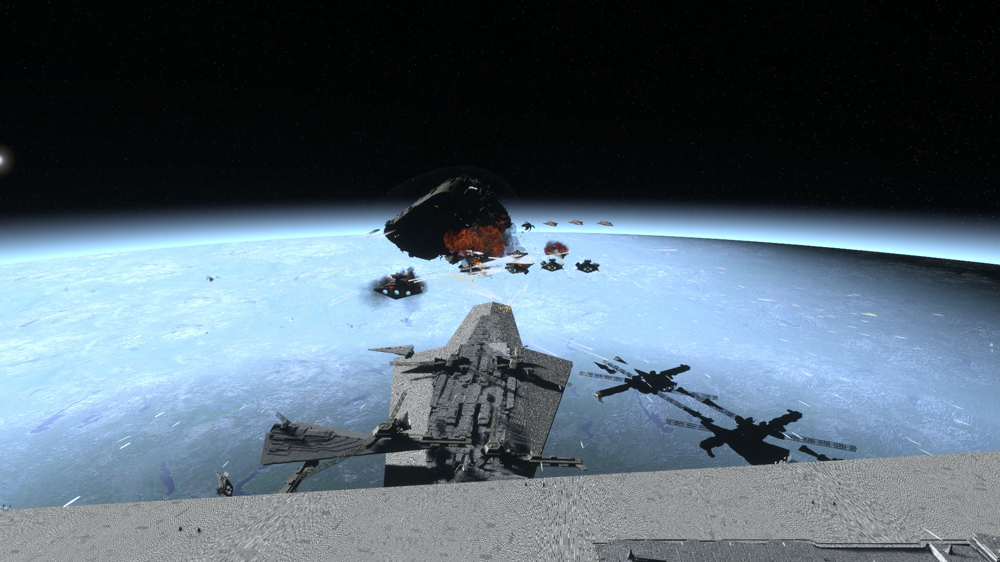
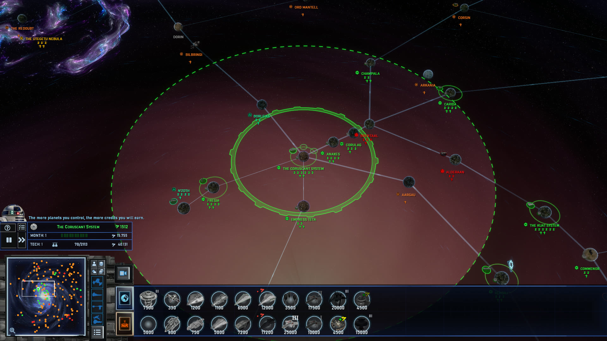
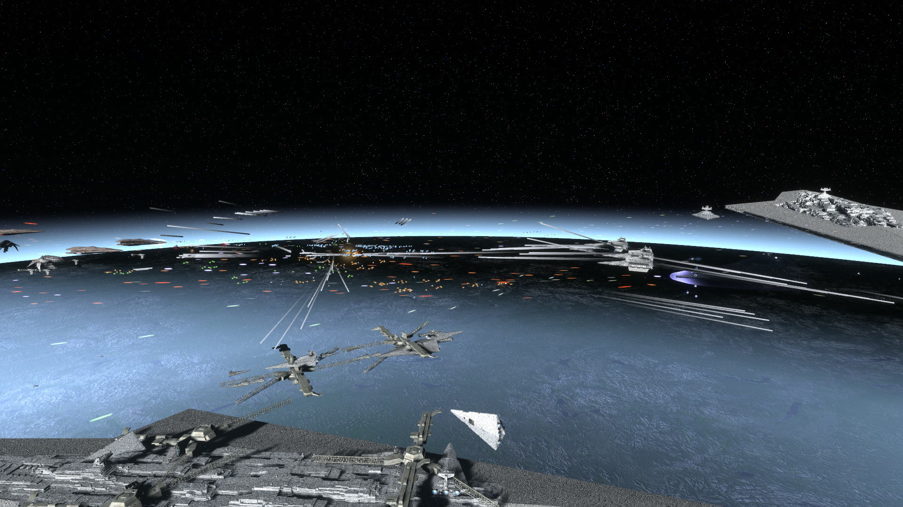

# EAW:Remake

An unofficial open-source Rust/Bevy reimplementation of **Galactic Conquest** and **space battles** for *Star Wars: Empire at War - Forces of Corruption* running the **[Empire at War Remake 4.0](https://steamcommunity.com/sharedfiles/filedetails/?id=1770851727)** modification.



> **Bring your own game:** this repository contains no game files - no models, textures, sounds or data. The engine reads your own Steam installation of the game and the subscribed Remake mod at runtime. The screenshots show the engine running with the original game and the Remake mod; their art belongs to Lucasfilm, Petroglyph and the Empire at War Remake team.



## What it is

The Remake's campaigns (Web Way Mini, Standard and Full with up to 145 planets, Clone Wars and more) for the playable
factions: planets, star bases and structures, fleets on hyperspace lanes, production queues, heroes, superweapons, AI
opponents with difficulty levels, save slots. Battles are real-time 3D space combat on the Remake's maps with hardpoints,
shields, squadrons, abilities, reinforcements and retreat. Unit stats, weapons and the economy come from the Remake's XML.
Ground battles, story campaigns and movies are out of scope.



## Requirements

* Windows 10/11 (64-bit) with a DirectX 12 or Vulkan graphics card.
* **[Star Wars: Empire at War - Gold Pack](https://store.steampowered.com/app/32470/STAR_WARS_Empire_at_War__Gold_Pack/)** on Steam and the subscribed Workshop mod **[Empire at War Remake 4.0](https://steamcommunity.com/sharedfiles/filedetails/?id=1770851727)**.

## Install

1. In Steam, install the game and subscribe to the mod. Let the download finish.
2. Download **`EAW-Remake-Setup-0.1.0.exe`** from the **[Releases page](https://github.com/msch128/eaw-remake/releases)** and run it.
   The setup is not code-signed, so Windows SmartScreen says "Windows protected your PC": click **More info**, then **Run anyway**.
3. Click through the setup. It installs for your user only (no administrator rights, no Visual C++ runtime needed) and checks that the game and the mod are there; if one is missing it says so and offers the Steam page.
4. Start **EAW Remake** from the Start menu. Uninstall it under Windows Settings > Apps; your saves and settings in `%APPDATA%\EAW-Remake` stay.

## Build from source

Clone the repository and double-click `build.bat`, or run:

```powershell
.\build.ps1
```

If Rust or the Microsoft C++ Build Tools are missing, the script installs them with `winget` first (the Build Tools ask for
an administrator confirmation). It then compiles `target\release\eaw-remake.exe`. `tools\package.ps1` builds the Windows
setup (it needs Inno Setup 6). More in [CONTRIBUTING.md](CONTRIBUTING.md).

## Run

Start `eaw-remake.exe` (or **EAW Remake** from the Start menu), pick a galaxy and your side. Settings are stored in
`%APPDATA%\EAW-Remake\settings.toml`, saves in `%APPDATA%\EAW-Remake\saves` and logs in `%APPDATA%\EAW-Remake\logs`.

### Finding the game

On startup the engine looks for your installation by itself:
1. It reads the Steam folder from the Windows registry.
2. It searches every Steam library in `libraryfolders.vdf` for *Empire at War* (app ID `32470`).
3. It looks for the Remake in `steamapps/workshop/content/32470/1770851727`.

If the game or the mod is somewhere else, pass the folders on the command line or as environment variables:

```powershell
eaw-remake.exe --game-dir "D:\Games\Star Wars Empire at War" --mod-dir "D:\Mods\1770851727"
```

* `EAW_GAME_DIR`: the game's root folder (`...\steamapps\common\Star Wars Empire at War`)
* `EAW_MOD_DIR`: the mod's folder (`...\steamapps\workshop\content\32470\1770851727`)

`eaw-remake.exe --check-install > check.txt` writes which folders were found.

### Useful command line options

| Flag | Description |
|---|---|
| `--campaign <ID>` | Start a campaign directly, e.g. `GC_Full_Web_Way_Rebel` or `GC_Standard_Web_Way_Imperial` |
| `--list-campaigns` | List all campaigns found in your installation |
| `--difficulty <d>` | AI difficulty of a new game: `easy`, `normal`, `hard`, `brutal`, `fair` |
| `--load-from <file>` | Start from a save file |
| `--fullscreen` | Start in borderless fullscreen |
| `--volume <0..1>` | Master volume |

`eaw-remake.exe --help` lists every option; most of the others are test hooks.

## Status

Preview. The maintainer plays galactic conquest and space battles live on Windows with sound, mouse and keyboard.
The offscreen smoke suite (`tools/smoke.ps1`) passes 28 of 29 rows, and about 820 automated tests pass. There are no
ground battles and no story campaigns, and the interface is English only. What is known to be missing or unverified is
listed in [docs/KNOWN-GAPS.md](docs/KNOWN-GAPS.md).

## Documentation

* [CONTRIBUTING.md](CONTRIBUTING.md): build, test, verify, conventions, playtest checklist, releasing.
* [docs/ARCHITECTURE.md](docs/ARCHITECTURE.md): crate map, pipeline, simulation versus rendering, where data comes from.
* [docs/RULES.md](docs/RULES.md): the game rules implemented, each marked as data, estimate or project rule.
* [docs/FORMATS.md](docs/FORMATS.md): the Alamo file formats and how they are read.
* [docs/KNOWN-GAPS.md](docs/KNOWN-GAPS.md): what is missing, how to see it, where it lives.
* [AGENTS.md](AGENTS.md): rules for coding agents working in this repository.

## Credits & Acknowledgments

For complete attributions and open-source library licenses, see [`CREDITS.md`](CREDITS.md).

* **The [Empire at War Remake](https://steamcommunity.com/sharedfiles/filedetails/?id=1770851727) Mod Team** (*The_Shooter*, *Jeroen G*, *Farseer*, *Alman*, and the Remake modding community) for their incredible work modernizing *Empire at War*.
* **Petroglyph Games** and **LucasArts** for creating the original *Star Wars: Empire at War*.
* **[Bevy Engine](https://bevy.org)** and the Rust community for the modern ECS and graphics ecosystem.

## Legal / Disclaimer

EAW:Remake is an independent, non-commercial fan-made project. It is **not affiliated with, authorized, sponsored, or endorsed by** The Walt Disney Company, Lucasfilm Ltd., LucasArts, Petroglyph Games, Valve Corporation, or the Empire at War Remake team.

*Star Wars* and all associated names, marks, logos, and emblems are registered trademarks of Lucasfilm Ltd. and Disney.

This repository contains **original source code only** and distributes **no game data**. The setup on the Releases page contains only this project's own program. Users must supply their own legally purchased copy of *Star Wars: Empire at War* and subscribe to the *Empire at War Remake 4.0* mod on Steam Workshop.

The source code is licensed under the [MIT License](LICENSE).
