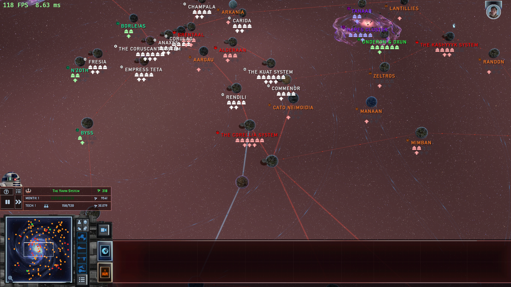
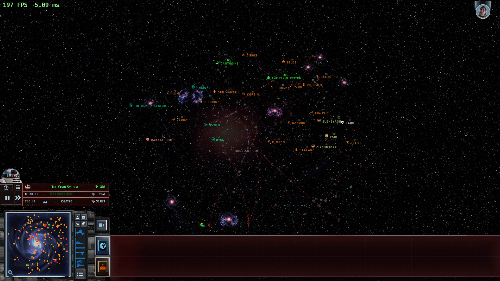

# EAW:Remake

An unofficial, high-performance open-source Rust/Bevy reimplementation of **Galactic Conquest** and **space battles** for *Star Wars: Empire at War - Forces of Corruption* running the **[Empire at War Remake 4.0](https://steamcommunity.com/sharedfiles/filedetails/?id=1770851727)** modification.



> **Clean-Room & Bring Your Own Game:** This repository contains **zero** copyrighted assets, models, textures, sounds, or game data. The engine dynamically parses your legally owned Steam installation and subscribed Steam Workshop mod files at runtime. No proprietary files or precompiled binaries are distributed.

---



## Current Status: playable, not finished (audit ~70 / 100)

An audit on 2026-10-14 put the project at roughly 70 out of 100 against the goal of playing Remake 4.0 Galactic Conquest with
space battles. The campaign loop runs from start to galactic victory, but fidelity to the Remake is partial.

| Area | Audit score |
|---|---|
| Galaxy UI | 74 |
| Galaxy rules / AI | 66 |
| Battle UI | 68 |
| Battle behaviour | 70 |
| Visuals | 72 |
| Audio | 45 (implemented, not yet heard live) |
| Stability | 78 |

### What exists
* **Galactic Conquest:** 145-planet maps with planet models, star base tiers and structures, five playable factions, three fleet
  slots per planet, production queues with cancel and refund, hyperlanes, superweapons, droid advisor menu, save slots and autosaves.
* **Space battles:** real-time 3D tactical combat with hardpoint damage, shield arcs, hangar launches, abilities, retreat,
  reinforcements, a unit-card bar, minimap and camera hotkeys.
* **Audio:** adaptive music, positional effects, unit speech and advisor lines are implemented but have not been verified by
  listening in a live session.
* **Engine:** deterministic headless sims (`galaxy-sim`, `battle-sim`) separate from rendering; Steam install and Workshop mod are
  found automatically. Performance numbers (4K, ~2 GB) predate the latest changes.

### Not verified
No sound has been heard live and no real mouse or keyboard input has been tested in the latest round; visual changes were
checked only in offscreen renders.

### Known gaps
Invented numbers still being replaced by data values, no source for the superweapon gauge art, missile arcs, ground-to-space
special weapons in battle, reinforcement placement polish, laser bolt look, per-group ability buttons, battle Esc menu and the
three autosave slots. The full list is in `HANDOFF.md` and `docs/QA-2026-10-09-user.md`.

---

## Requirements

- **Operating System:** Windows 10/11 (x64)
- **Base Game:** A legally owned copy of [Star Wars: Empire at War - Gold Pack on Steam](https://store.steampowered.com/app/32470/STAR_WARS_Empire_at_War__Gold_Pack/) (includes *Forces of Corruption*).
- **Mod:** Subscribed to [Empire at War Remake 4.0 on Steam Workshop](https://steamcommunity.com/sharedfiles/filedetails/?id=1770851727) (Steam Workshop ID `1770851727`).
- **Build Tools:** Rust toolchain (stable) and MSVC C++ Build Tools (`build.ps1` automatically detects and installs them if missing).

---

## Getting Started

### 1. Build

Clone the repository and run the PowerShell build script:

```powershell
.\build.ps1
```

This compiles optimized release binaries:
- `target\release\eaw-remake.exe` (primary executable)
- `target\release\space-peace.exe` (backwards-compatible alias)

### 2. Run

Launch the game executable:

```powershell
.\target\release\eaw-remake.exe
```

### Auto-Detection & Custom Paths

The engine automatically discovers your Steam installation on startup:
1. Queries the Windows Registry for the Steam installation directory.
2. Scans all active Steam libraries in `libraryfolders.vdf` for *Empire at War* (App ID `32470`).
3. Discovers the Remake mod in `steamapps/workshop/content/32470/1770851727`.

If your game or mod files reside in a custom location, specify them via command line or environment variables:

* **Command Line Flags:**
  ```powershell
  .\target\release\eaw-remake.exe --game-dir "D:\Games\Star Wars Empire at War" --mod-dir "D:\Mods\1770851727"
  ```
* **Environment Variables:**
  * `EAW_GAME_DIR`: Root folder of the game (`.../steamapps/common/Star Wars Empire at War`)
  * `EAW_MOD_DIR`: Root folder of the mod (`.../steamapps/workshop/content/32470/1770851727`)

### Useful Command Line Options

| Flag | Description |
|---|---|
| `--campaign <ID>` | Launch directly into a campaign (e.g. `GC_Full_Web_Way_Rebel`, `GC_Standard_Web_Way_Imperial`) |
| `--faction <Name>` | Choose human faction (`Rebel`, `Empire`, `Underworld`, `Republic`, `CIS`) |
| `--list-campaigns` | List all discovered Galactic Conquest scenarios |
| `--fullscreen` | Run in borderless fullscreen mode |
| `--volume <0.0..1.0>` | Set master audio volume (e.g. `--volume 0.8`) |
| `--offscreen <file.png>` | Render N frames headlessly directly to an image file |

User configuration (window mode, resolution, volume, graphics preferences) is stored in `%APPDATA%\SpacePeace\settings.toml`.

---

## Architecture

The project is structured into modular, decoupled Rust crates:

| Crate | Responsibility |
|---|---|
| `alamo-fs` | Virtual layered file system (`GameFs`), `.MEG` archive reading, Steam path discovery |
| `alamo-data` | Lenient XML parsing, string tables (`.DAT`), game objects, units, campaigns |
| `alamo-model` | 3D Alamo geometry (`.ALO`), skeletal animation (`.ALA`), particle systems, DDS textures |
| `alamo-map` | Alamo tactical space battle map reader (`.TED`) |
| `alamo-audio` | Audio decoding (WAV, ADPCM, MP3), music playlists, 3D sound effects, speech events |
| `alamo-lua` | Lua runtime for story scripts, trigger evaluation, and scripted campaign events |
| `galaxy-sim` | Headless, deterministic Galactic Conquest simulation (economy, fleets, conquest, builds) |
| `battle-sim` | Headless, deterministic, multi-threaded 3D tactical space battle simulation |
| `galaxy-script` | Galactic script bridge connecting Remake plot scripts with `galaxy-sim` |
| `galaxy-ai` | Galactic AI strategic planning, fleet defense, expansion, and invasion logic |
| `alamo-render` | Bevy rendering plugin: custom Alamo PBR shaders, laser bolts, engine trails, particles |
| `battle-view` | Bevy tactical battle plugin: 3D scene representation, camera controls, combat UI |
| `eaw-ui` | Ingame user interface and HUD components rebuilt from Alamo game data |
| `galaxy-play` | Galactic Conquest UI, fleet movement interaction, planet view, build queues |
| `space-peace` | Main application executable: lifecycle management, campaign select, save/load, settings |

---

## Design Principles

* **Strict Clean-Room Architecture:** Zero game assets or proprietary binaries in the repository. Everything is parsed at runtime from the user's local installation.
* **Deterministic Simulations:** Simulations are decoupled from graphics and frame rates, free of global mutable state, and fully journaled for reliable replays and save games.
* **Data-Driven Rules:** Unit statistics, weapon parameters, and economic values come directly from the Remake XML files—never hardcoded or invented.
* **Fault-Tolerant Parsers:** Undecoded chunks or non-standard mod syntax produce warnings rather than fatal crashes.

---

## Credits & Acknowledgments

For complete attributions and open-source library licenses, see [`CREDITS.md`](CREDITS.md).

* **The [Empire at War Remake](https://steamcommunity.com/sharedfiles/filedetails/?id=1770851727) Mod Team** (*The_Shooter*, *Jeroen G*, *Farseer*, *Alman*, and the Remake modding community) for their incredible work modernizing *Empire at War*.
* **Petroglyph Games** and **LucasArts** for creating the original *Star Wars: Empire at War*.
* **[Bevy Engine](https://bevy.org)** and the Rust community for the modern ECS and graphics ecosystem.

---

## Legal / Disclaimer

EAW:Remake is an independent, non-commercial fan-made project. It is **not affiliated with, authorized, sponsored, or endorsed by** The Walt Disney Company, Lucasfilm Ltd., LucasArts, Petroglyph Games, Valve Corporation, or the Empire at War Remake team.

*Star Wars* and all associated names, marks, logos, and emblems are registered trademarks of Lucasfilm Ltd. and Disney.

This repository contains **strictly original software source code** and distributes **no copyrighted game data**. Users must supply their own legally purchased copy of *Star Wars: Empire at War* and subscribe to the *Empire at War Remake 4.0* mod on Steam Workshop.

The source code is licensed under the [MIT License](LICENSE).
